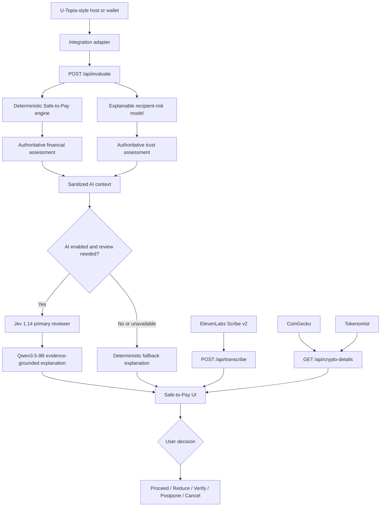

# U-HANDSHAKE

**Think Before You Pay.**

U-HANDSHAKE is an integration-ready financial decision-safety layer for Gen Z and first-jobbers. It sits immediately before transaction confirmation and answers a question that a wallet balance cannot:

> Can I make this payment without putting my bills, debt commitments, or emergency buffer at risk?

The prototype is presented as a **U-Topia Reference Integration Preview**. It combines deterministic financial calculations, an explainable recipient-risk model, a guarded AI explanation pipeline, voice input, and optional crypto-market context while leaving the final decision with the user.

- [Live demo](https://u-hackathon-2026-sepia.vercel.app/)
- [GitHub repository](https://github.com/beamtanawat/U-Hackathon-2026)

## Hackathon Context

U-HANDSHAKE was built for **U-Hackathon 2026 during a 24-hour hackathon** as a judge-ready demonstration of how a financial safety layer could be embedded into a wallet or banking experience. The team used U-Topia as the reference host interface and focused the prototype on three hackathon goals: a clear real-world problem, an integration-ready workflow, and an experience that judges can understand through repeatable scenarios.

The project combines the event's AI and partner-service opportunities without placing critical financial decisions in a black box. Deterministic calculations remain authoritative, while the U-Bot Simulation, voice input, and market context help explain risk and guide the user before a transaction is confirmed.

## The Problem

Account balances show what a person *can* pay, not what is *safe* to pay. For people early in their careers, upcoming bills, debt repayments, emergency savings, and financial goals are often fragmented across different services.

This becomes more dangerous when a transaction also carries scam signals such as urgency, secrecy, a new recipient, impersonation, or guaranteed-return language. Most financial products explain what happened after a transaction. U-HANDSHAKE introduces a decision checkpoint before the money leaves.

## How It Works

The spending wallet is partitioned into three understandable zones:

- **Must Keep** — upcoming bills and debt commitments
- **Protected Buffer** — emergency savings protected from everyday spending
- **Safe-to-Spend** — money available after the first two zones are covered

Before confirmation, the system:

1. Normalizes the proposed transaction and its data provenance.
2. Calculates the financial impact using deterministic rules.
3. Evaluates recipient and scam-context signals independently.
4. Produces separate financial and trust statuses.
5. Adds an optional guarded AI explanation or a deterministic fallback.
6. Presents user-controlled actions such as **Proceed, Reduce, Verify, Postpone, or Cancel**.

U-HANDSHAKE never silently changes financial values and never automatically blocks or executes a payment.

## Demo Scenarios

| Scenario | Purpose | Expected result |
| --- | --- | --- |
| **A — Safe U-Tag payment** | Normal payment to a known recipient | Commitments remain covered; financial status is Safe and recipient risk is Low |
| **B — Main demo** | Balance covers the payment, but Safe-to-Spend does not | Shows the shortfall and which commitments would be affected |
| **C — Scam signals** | New crypto recipient with urgency, secrecy, and guaranteed-return language | Affordability remains separate from a High recipient-risk result and verification flow |

The demo uses fictional balances, holdings, recipients, and transactions. No real money moves.

## Key Features

- Pre-transaction **Safe-to-Pay** checkpoint
- Wallet partitioning into Must Keep, Protected Buffer, and Safe-to-Spend
- Before-and-after financial impact with affected commitments
- Separate financial-risk and recipient-risk assessments
- Explainable logistic-regression recipient-risk model with deterministic policy floors
- Five-step recipient-verification checklist for suspicious transfers
- U-Bot Simulation with confirmed wallet-partition changes
- Thai and English push-to-talk input through ElevenLabs
- CoinGecko USD market context and seven-day charts when available
- Tokenomist upcoming token-unlock context when available
- Seven-step product walkthrough and three judge-ready scenarios
- Graceful fallback when optional AI or external providers are unavailable

## Architecture



### Decision Boundary

The financial and trust engines are authoritative. AI is advisory:

- It cannot change balances, Safe-to-Spend, risk statuses, or the user's decision.
- It receives sanitized status and evidence identifiers rather than transaction amounts, balances, recipient identifiers, wallet addresses, or private messages.
- Provider output must pass schema validation, evidence comparison, and grounding checks.
- Unsupported claims, invented numbers, certainty claims, or pressure to proceed cause the response to be rejected in favor of deterministic copy.

## Technology Stack

| Layer | Technology |
| --- | --- |
| Application | Next.js 16, React 19 |
| Language and validation | TypeScript, Zod |
| Runtime | Node.js 22.12 or later |
| Financial logic | Deterministic TypeScript engine |
| Recipient-risk model | Explainable logistic regression plus deterministic critical rules |
| AI orchestration | OpenRouter, Jev 1.14, Qwen3.5-9B |
| Voice | ElevenLabs Scribe v2 |
| Crypto market context | CoinGecko |
| Token unlock context | Tokenomist |
| Unit and API tests | Vitest |
| End-to-end tests | Playwright |
| Deployment | Vercel |

## APIs and Integrations

| Endpoint | Role | External dependency |
| --- | --- | --- |
| `POST /api/evaluate` | Validates input and returns authoritative financial and trust assessments with an optional AI explanation | OpenRouter only when live AI is enabled |
| `GET /api/transcribe` | Reports whether voice input is enabled | None |
| `POST /api/transcribe` | Converts a short Thai or English recording into reviewable text | ElevenLabs |
| `GET /api/crypto-details?symbols=...` | Returns display-only USD market data and upcoming unlock context | CoinGecko and Tokenomist |
| `GET /api/token-context?symbols=...` | Returns Tokenomist tokenomics context for allow-listed demo holdings | Tokenomist |

All external API keys remain server-side. Provider calls use validation, timeouts, rate limits, bounded budgets, caching where appropriate, and explicit disabled/unavailable states.

### U-Bot Simulation

No official U-Bot API was available for this hackathon. The product therefore labels the assistant **U-Bot Simulation** and discloses the actual implementation:

- **Jev 1.14** is the primary typed reviewer.
- **Qwen3.5-9B** is the secondary explanation and evidence-review model.
- A deterministic fallback keeps the experience usable when paid AI is off or a provider fails.
- Safe scenario A requires no paid AI call.

The live deployment may run the rule-based fallback rather than paid models. This is intentional and does not affect the authoritative financial or trust result.

### ElevenLabs

The voice flow uses `scribe_v2` with automatic Thai and English detection:

1. The user records a short message.
2. The server sends the audio to ElevenLabs.
3. Only the transcript is returned to the input field.
4. The user reviews it and presses Send.
5. Any proposed wallet-partition change still requires explicit confirmation and API re-evaluation.

The application does not store or log the uploaded recording.

### CoinGecko and Tokenomist

The Crypto Wallet can display:

- USD price, 1-hour/24-hour/7-day change, 24-hour range, and seven-day chart from CoinGecko
- Upcoming unlock date, amount, event value relative to market capitalization, and allocation details from Tokenomist

The integrations fail independently. If one provider is disabled, rate-limited, not covering a token, or temporarily unavailable, holdings and Safe-to-Pay continue working while the UI reports partial availability.

Crypto data is informational only:

- Holdings are fictional.
- No USD-to-THB exchange rate is invented.
- Crypto is not included in the THB Safe-to-Spend calculation.
- Token data is not presented as personalized investment advice.

## Local Development

### Requirements

- Node.js 22.12 or later
- npm

### Setup

```bash
git clone https://github.com/beamtanawat/U-Hackathon-2026.git
cd U-Hackathon-2026
npm ci
```

Create a local environment file only if you want to enable optional providers:

```bash
# macOS or Linux
cp .env.example .env.local
```

```powershell
# Windows PowerShell
Copy-Item .env.example .env.local
```

Start the application:

```bash
npm run dev
```

Open [http://localhost:3000](http://localhost:3000). External services are off by default, so the core deterministic demo works without API keys.

## Environment Variables

| Variable | Purpose |
| --- | --- |
| `AI_MODE=live` | Enables paid Jev and Qwen calls when an OpenRouter key is present |
| `OPENROUTER_API_KEY` | Server-side OpenRouter key |
| `AI_MAX_CALLS_PER_HOUR` | Per-instance AI call budget; default 20 |
| `ELEVENLABS_STT_MODE=live` | Enables speech-to-text |
| `ELEVENLABS_API_KEY` | Server-side ElevenLabs key |
| `ELEVENLABS_STT_MAX_PER_HOUR` | Per-instance transcription budget; default 30 |
| `COINGECKO_MODE=live` | Enables CoinGecko market requests |
| `COINGECKO_API_KEY` | Server-side CoinGecko key |
| `COINGECKO_API_TIER` | `demo` or `pro`; selects the matching host and header |
| `TOKENOMIST_MODE=live` | Enables Tokenomist requests |
| `TOKENOMIST_API_KEY` | Server-side Tokenomist key |
| `TOKENOMIST_MAX_CALLS_PER_DAY` | Per-instance Tokenomist budget; default 24 |

Never expose these values through `NEXT_PUBLIC_*`.

## Testing

```bash
# Unit and API tests
npm test

# Type checking
npm run typecheck

# Production build
npm run build

# Install the Playwright browser once
npm run e2e:install

# Production-build end-to-end suite
npm run test:e2e
```

The E2E configuration explicitly disables paid AI, voice, CoinGecko, and Tokenomist calls. Tests therefore remain deterministic and do not consume provider credits.

## Project Structure

```text
app/api/                    Next.js API routes
data/                       Demo fixtures
docs/                       Architecture and integration documentation
examples/demo-scenarios/    Canonical Scenario A/B/C requests and results
lib/api/                    Validation, guards, adapters, and route handlers
lib/engine/                 Deterministic Safe-to-Pay calculation
lib/ml/                     Explainable recipient-risk model and features
lib/ai/                     Jev/Qwen orchestration, grounding, and fallback
lib/market/                 CoinGecko and Tokenomist server integrations
public/                     U-Topia reference UI and U-Bot partition logic
tests/                      Unit, API, and end-to-end tests
```

More detailed contracts are documented in:

- [Financial and trust engine integration](docs/financial-engine-integration.md)
- [AI integration](docs/ai-integration.md)
- [Frontend/API integration](docs/frontend-ai-integration.md)
- [Crypto details integration](docs/crypto-details-integration.md)

## Hackathon Engineering Highlights

- **Deterministic-first architecture:** money calculations never depend on an LLM.
- **API-less U-Bot simulation:** the missing official U-Bot API is represented honestly while the adapter and safety boundaries remain integration-ready.
- **Grounded dual-model review:** Jev and Qwen are advisory and their output is rejected when it is unsupported.
- **One request for multiple holdings:** crypto details are batched and cached to conserve limited provider credits.
- **Independent provider degradation:** Safe-to-Pay continues operating when AI, voice, CoinGecko, or Tokenomist is unavailable.
- **Explicit confirmation boundaries:** voice, AI suggestions, and partition edits cannot silently alter financial state.
- **Reference-faithful host integration:** the prototype demonstrates the pre-confirmation insertion point without copying real U-Topia customer data or claiming access to unconfirmed APIs.

## Integration Milestones

The final hackathon build was assembled through reviewed pull requests. One late-stage integration completed the production-facing experience:

- [**PR #10 — Live crypto prices, token-unlock details, and production voice coverage**](https://github.com/beamtanawat/U-Hackathon-2026/pull/10): added the unified `/api/crypto-details` route, batched CoinGecko market data, Tokenomist unlock context, independent provider fallbacks, wallet detail panels, and expanded API and end-to-end coverage for token details and ElevenLabs voice behavior.

This integration preserved the project's core rule: optional services may degrade, but Safe-to-Pay must keep working and must never invent financial data.

## Safety and Scope

- This is a hackathon simulation, not financial advice.
- No real funds are held, transferred, approved, or blocked.
- No production authentication, custody, AML screening, or sanctions screening is included.
- Recipient-risk signals are indicators, not proof that someone is a scammer.
- The project does not claim an official U-Topia or U-Bot integration.
- The current prototype is not built on Avalanche.
- Tokenomist usage must follow the applicable provider plan and licensing terms.

## Contributors

- [**Archay**](https://github.com/arcdoesntexist) — project manager, deterministic financial engine and explainable recipient-risk model
- [**Ete**](https://github.com/Ate21538) — U-Topia reference frontend and user experience
- [**Beam**](https://github.com/beamtanawat) — guarded AI pipeline, U-Bot Simulation, and external-service integration
- [**Bream**](https://github.com/kodchakorn18) — business direction, product framing, and pitch alignment

## Team Workflow

The team used Notion as the project command center for research, requirements, product direction, ownership, and progress updates. Work was developed on separate branches according to the responsibilities above.

Changes were reviewed and integrated through pull requests before deployment to Vercel.

## Status

The core prototype, judge scenarios, API contracts, automated tests, and Vercel deployment are implemented. External provider availability depends on deployment configuration, API coverage, provider quotas, and upstream health; the UI reports those states rather than fabricating missing data.
